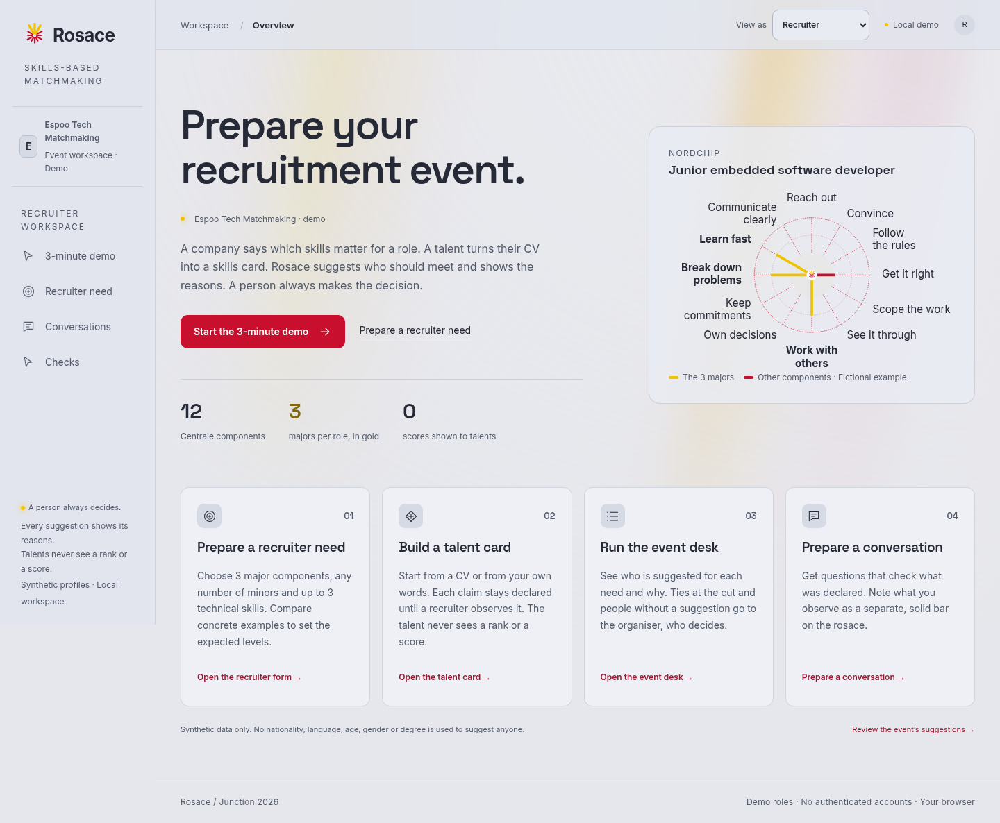

# Frontend refinement — Impeccable

The critique and eight priorities are in [UX_AUDIT_IMPECCABLE.md](UX_AUDIT_IMPECCABLE.md). This pass starts at `8742471` and changes presentation, accessibility markup and browser regression tests only. The earlier Claude integration is a separate commit.

## What changed

- Level cards fit their working column, including Advanced, with readable examples and explicit selected radios.
- Mobile actions sit below the form instead of covering focused inputs. Repeated header spacing, context blocks and organiser selection tiles are more compact.
- Rosaces use less unused outer space; their scale, branch geometry and values are unchanged. Technical names and expected levels wrap on separate lines.
- Observation rows separate the skill, verification method and saved result. Human grading uses comfortable, visibly selected controls.
- Pearl surfaces distinguish the working panel from quiet supporting context; redundant introductory labels and miniature level illustrations are removed.
- Animated numbers/headings expose stable accessible text; technical skills use a labelled list. Focusable desktop preview panels support vertical keyboard scrolling.
- Placeholder and gold-text contrast is stronger; the existing SVG icon vocabulary replaces missing diagonal-arrow glyphs.
- Review actions align, and the existing delete-card action is separated from saving.

No API, storage, authentication, scoring, schemas or business rules were changed in this UI pass. No new marketing claims or functional steps were added.

## See it locally

From an existing clean checkout in Cursor:

```bash
git fetch origin
git switch feat/coherent-ux
git pull --ff-only origin feat/coherent-ux
npm ci
npm run dev
```

Open http://localhost:3000 on the computer running that command. The later [welcome follow-up](WELCOME_REVIEW.md) now provides the initial choice and a Demo profile menu; the captures below document the preceding UI milestone. An API key is unnecessary for the fictional demo; optional Claude setup is in [CLAUDE_SETUP.md](CLAUDE_SETUP.md).

## Before / after

Earlier screenshots: [Claude workspaces baseline](images/claude-workspaces).

| View | Desktop | Mobile |
|---|---|---|
| Overview | [Open](images/impeccable/home-1440x900.png) | [Open](images/impeccable/home-390x844.png) |
| Guided demo | [Open](images/impeccable/tour-1440x900.png) | [Open](images/impeccable/tour-390x844.png) |
| Recruiter intake | [Open](images/impeccable/need-1440x900.png) | [Open](images/impeccable/need-390x844.png) |
| Technical level choices | [Open](images/impeccable/technical-1440.png) | [Open](images/impeccable/technical-390.png) |
| Candidate intake | [Open](images/impeccable/talent-1440x900.png) | [Open](images/impeccable/talent-390x844.png) |
| Event desk | [Open](images/impeccable/organiser-1440x900.png) | [Open](images/impeccable/organiser-390x844.png) |
| Conversations | [Open](images/impeccable/conversations-1440.png) | [Open](images/impeccable/conversations-390.png) |
| Conversation brief | [Open](images/impeccable/brief-1440x900.png) | [Open](images/impeccable/brief-390x844.png) |
| Recruiter checks | [Open](images/impeccable/checks-1440x900.png) | [Open](images/impeccable/checks-390x844.png) |
| Candidate checks | [Open](images/impeccable/candidate-checks-1440x900.png) | [Open](images/impeccable/candidate-checks-390x844.png) |

[Mobile observation grid](images/impeccable/observation-390.png) · [Human-graded exercise](images/impeccable/checks-graded.png)



## Verification and limits

See [VALIDATION.md](VALIDATION.md) for checks and test counts. The three added browser regressions test actual focus hit targets, level-card containment at five widths, accessible counters, chart-label bounds and untruncated review metadata.

The Impeccable source detector still reports six style warnings: five accent-border declarations (including one duplicate) and an overridden gradient-text declaration. The meaningful major/status/quote accents and the requested Aurora are intentional; no warning-ignore rules were added. The rendered placeholder, counters, heading and overflow defects were verified separately.

Axe inspected ten unique initial routes at desktop and mobile. Remaining label/name reports concern the decorative brand tagline and SVG buttons: the detector includes decorative or hidden title text, while the accessible names identify Rosace and the exact component. Automated checks do not certify screen-reader or real-device support; layered-background contrast also needs visual review.

Audit provenance: two independent agents, source slug `src-app`, no ignore list, one baseline critique at 25/40 (no trend yet). Browser detector injection succeeded in five headless tabs; there is no shared user-visible overlay. Its temporary server was stopped with `--keep-inject`. Temporary report bodies were removed; the critique is archived. The CLI archives directory targets when `latest` cannot fingerprint a regular file; that automatic archive flag is not evidence of resolution. This document and the browser checks record the actual corrections.

Skill: [official Impeccable SKILL.md](https://github.com/pbakaus/impeccable/blob/main/.agents/skills/impeccable/SKILL.md), version 4.9.1. No skill runtime or dependency was added to the application.
