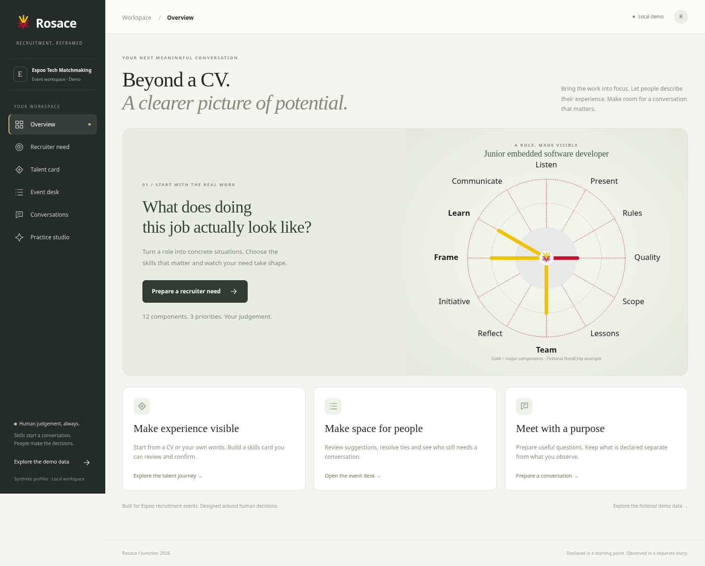
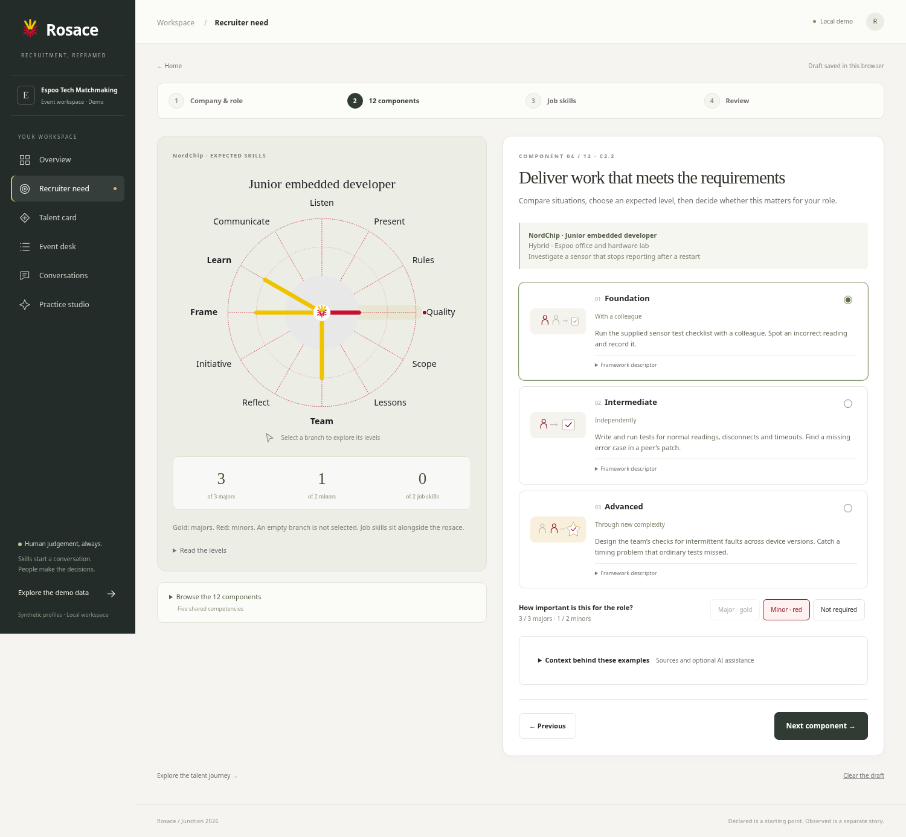
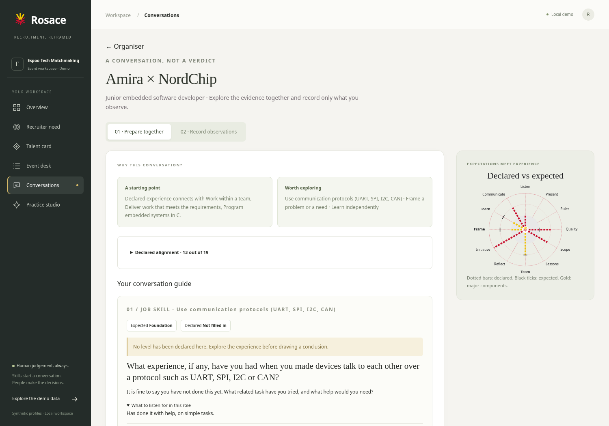

# Interactive workspace delivery

The application is delivered on `feat/visual-workspace`. The audit-only branch
`cursor/audit-strategie-hackathon-9b3f` does not contain this implementation.
Until the application PR is merged, check out the application branch in Cursor.

```bash
git fetch origin
git switch feat/visual-workspace
npm ci
npm run dev
```

Open http://localhost:3000. On Windows use `npm.cmd` if PowerShell blocks npm's
script. Node.js 24 LTS is recommended. Install dependencies once and after lockfile
changes; later starts need only `npm run dev`. The optional `start-local.cmd`
launcher opens the browser on port 3001 and reuses an existing installation.

## What changed

- One workspace navigation across recruiter, talent, event desk and conversations.
- Company, role and working context in three short stages; a fictional role helps
  explore the flow without inventing input. Imported text remains editable.
- An interactive rosace: select a branch with a mouse or Tab/arrow keys/Enter.
  Declared and expected values retain the fixed Centrale scale. Reduced-motion
  preferences disable the branch transition.
- Illustrated level cards, with concrete examples first and descriptors on demand.
- One company need at a time in the event desk, with expandable talent reviews.
- Conversation questions start with missing/unknown and below-expected declarations.
  The brief explains why to discuss them and shows the expected job situation.
  A/C/F/NE observations remain separate and never modify the declared card.
- Featherless is now the preferred optional AI provider. Server routes validate
  generated JSON, citations and answer quotes; humans review proposals. The
  previous Gemini adapter is optional, not a requirement for the app.

## Art direction

- Night chrome (sidebar and home hero) and white working surfaces. Centrale red
  `#C8102E` and gold `#F0C300` are the only accent colours; the old cream, green
  and Georgia serif styling is gone.
- Fonts are self-hosted with `@fontsource-variable`: Space Grotesk for headings,
  Inter for text. No request to Google Fonts at runtime.
- Effects come from free Aceternity UI components, recoloured in Centrale red and
  gold: `WavyBackground` (canvas and `simplex-noise`) behind the home hero, and
  `GlowingEffect`, a border glow that follows the pointer, on the home steps and the
  event desk need cards. Both pause or stay still under reduced motion. The paid
  Aceternity shader blocks are not used.
- Copy says what the tool does. Avoid slogans such as "Beyond a CV".

## Frontend and backend

Next.js hosts both layers in one repository:

- React client components render the workspace and rosaces in the browser.
- Node.js route handlers in `src/app/api` call Context.dev and the selected AI
  provider. Credentials stay on the server. The scoring modules remain deterministic.
- Browser storage is still the persistence layer for this local demo. Shared
  PostgreSQL data, authentication and production rate limits are future work.

## Verification

- 120 application tests, including discussion-gap and Featherless adapter tests.
- Four launcher tests.
- TypeScript, ESLint and production build pass.
- Five Chromium journey tests pass against the production build: real synthetic
  PDF/DOCX import, recruiter-to-observation flow, keyboard chart interaction,
  restore behaviour, mobile/tablet/desktop overflow, and explicit acceptance of
  mocked Featherless proposals.
- No live provider generation was performed. The public Featherless model list
  was reachable; API credentials and a selected model are still needed to check
  real inference. See INTEGRATIONS.md.
- Windows batch execution is not verified on a Windows machine in this environment.

## Actual browser captures






