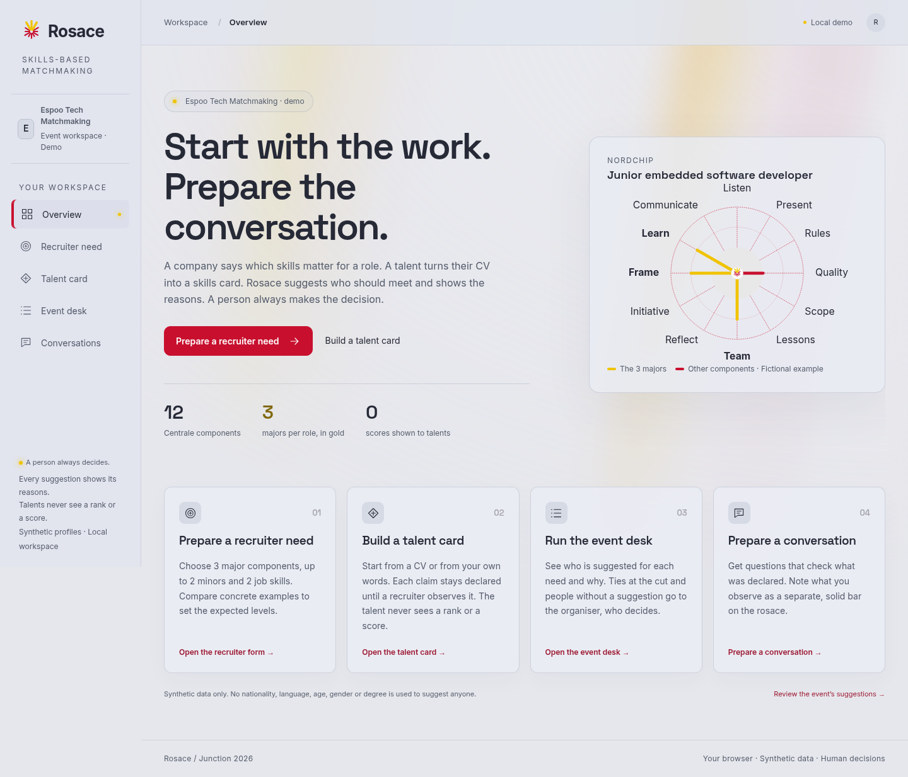
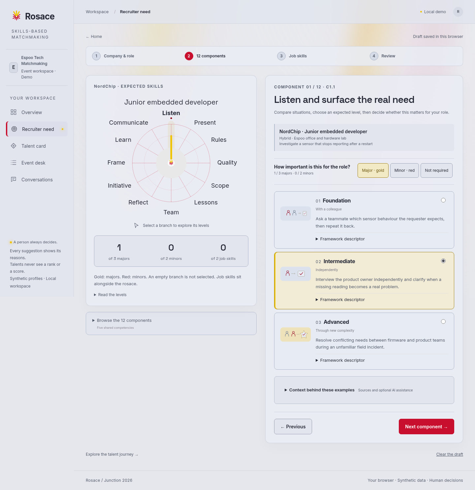
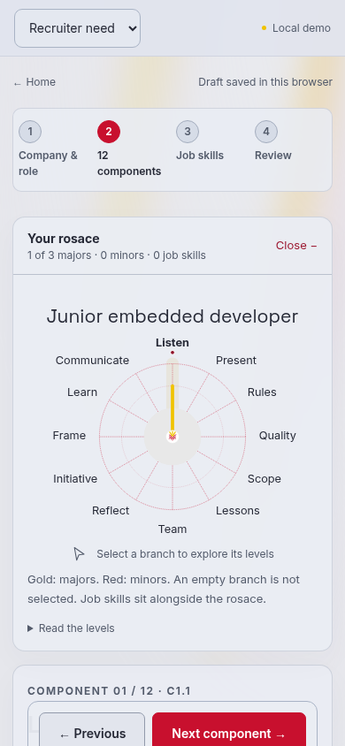

# Interactive workspace delivery

The latest UX update is delivered on `feat/coherent-ux`, based on
`shader-art-direction` and the original `feat/visual-workspace` application. The audit-only branch
`cursor/audit-strategie-hackathon-9b3f` does not contain this implementation.
Until the application PR is merged, check out the application branch in Cursor.

```bash
git fetch origin
git switch feat/coherent-ux
npm ci
npm run dev
```

Open http://localhost:3000. On Windows use `npm.cmd` if PowerShell blocks npm's
script. Node.js 24 LTS is recommended. Install dependencies once and after lockfile
changes; later starts need only `npm run dev`. The optional `start-local.cmd`
launcher opens the browser on port 3001 and reuses an existing installation.

## What changed

- One workspace navigation across recruiter, talent, event desk and conversations.
- Company, role and working context in three short stages; a fictional role helps
  explore the flow without inventing input. Imported text remains editable.
- An interactive rosace: select a branch with a mouse or Tab/arrow keys/Enter.
  Declared and expected values retain the fixed Centrale scale. Reduced-motion
  preferences disable the branch transition.
- Illustrated level cards, with concrete examples first and descriptors on demand.
- One company need at a time in the event desk, with expandable talent reviews.
- Conversation questions start with missing/unknown and below-expected declarations.
  The brief explains why to discuss them and shows the expected job situation.
  A/C/F/NE observations remain separate and never modify the declared card.
- Featherless is now the preferred optional AI provider. Server routes validate
  generated JSON, citations and answer quotes; humans review proposals. The
  previous Gemini adapter is optional, not a requirement for the app.

## Art direction

- Following the owner's approved UX audit and request for a lighter background,
  all roles share a light pearl palette: matching navigation, fields, level cards
  and translucent surfaces. There is no dark sidebar or isolated white chart panel.
- `AuroraBackground` adapts the freely available [Aceternity Aurora Background](https://ui.aceternity.com/components/aurora-background):
  layered repeating gradients, a radial mask and a slow 60-second animation, tinted
  in Centrale red and gold. It fills the viewport across routes and becomes static
  under reduced motion. This is CSS, not a paid WebGL shader or an AI call.
- Fonts remain self-hosted Space Grotesk and Inter. Larger chart labels and form
  text make both mobile and projected demonstrations easier to read.
- `theme.css` owns the shared palette and the responsive preview treatment.
  `workspace.css` retains the existing layout. The old WavyBackground and
  GlowingEffect are not mounted by the workspace.

## UX audit fixes

- Only confirmed, consented talent levels and the display name are restored on
  return; CV text, quoted passages and question answers are never restored.
  Expired cards still follow the existing six-month deletion rules.
- Mobile navigation uses an explicit destination selector; a sticky expandable
  rosace stays accessible while filling in forms. Desktop keeps the full chart.
- Recruiters can preview a level before selecting a priority. A neutral provisional
  branch is clearly labelled and is never saved as a requirement by itself.
  Review becomes directly available after the third major is chosen.
- Organiser decision errors sit beside their reason input, with focus moved to
  that field. Approvals remain human decisions and keep their journal entry.
- Observation changes announce that they were saved. The original declaration
  can be inspected separately without changing the scoring or observation rules.
- Practice stays reachable by its URL but is removed from the main demo journey.
  Demo data remains an organiser annex. The interface consistently states the
  existing limit of two job skills; scoring is unchanged.

## Frontend and backend

Next.js hosts both layers in one repository:

- React client components render the workspace and rosaces in the browser.
- Node.js route handlers in `src/app/api` call Context.dev and the selected AI
  provider. Credentials stay on the server. The scoring modules remain deterministic.
- Browser storage is still the persistence layer for this local demo. Shared
  PostgreSQL data, authentication and production rate limits are future work.

## Verification

- 120 application tests, including discussion-gap and Featherless adapter tests.
- Four launcher tests.
- TypeScript, ESLint and production build pass.
- Eleven Chromium journey tests pass against the production build: real synthetic
  PDF/DOCX import, recruiter-to-observation flow, keyboard chart interaction,
  restore behaviour, mobile/tablet/desktop overflow, and explicit acceptance of
  mocked Featherless proposals.
- No live provider generation was performed. The public Featherless model list
  was reachable; API credentials and a selected model are still needed to check
  real inference. See INTEGRATIONS.md.
- Windows batch execution is not verified on a Windows machine in this environment.

## Actual browser captures







## Framing delivery: steps 0–9

- Three integrated branches: `framing-doc`, `workspace-concrete-skills`, `guided-demo`. No GitHub PR is merged by this delivery.
- The menu now shows **3-minute demo**, Recruiter need, Talent card, Event desk, Conversations and Checks. The logo returns home; `/demo` remains available by URL.
- The twenty technical skills include the owner's approved **Build data pipelines**. Three are allowed per need, beside the fixed twelve-component rosace. There is no extra cap on minor components.
- Observed branches use the mean of task-level performance values, with NE ignored and F counted as zero. Expected, declared and observed values all use the same scale from the hub. Regrading a situation replaces it; another situation is kept separately.
- `/checks` replaces `/practice`: C5.1, C2.2 and embedded C each have three written variants. The talent's declared level selects the variant. The demo has an explicit Talent/Recruiter switch: submit, review the checklist, then grade A/C/F/NE. Replacing an answer removes its old grade. Fictional answers and grades persist in this browser; CV text does not.
- The brief shows on-site situations within a shared ten-minute allowance. C4.3 is **Discussed, not observed**. Other online exercises are described as requiring recruiter preparation; the three demo exercises do not claim to implement every verification task.
- `/tour` follows NordChip and Amira through four stages; its final stage includes a clearly labelled fictional online grade.
- Free Aceternity adaptations add a word reveal, pointer glow and discreet beams to the Aurora background. Rosace branches, observed fills, suggestions, transitions and counters explain progress. Reduced-motion preferences make them static.
- Aiven Runtime packaging is ready for account validation, without PostgreSQL or a deployment. See [DEPLOY_AIVEN.md](DEPLOY_AIVEN.md) and [VALIDATION.md](VALIDATION.md).
