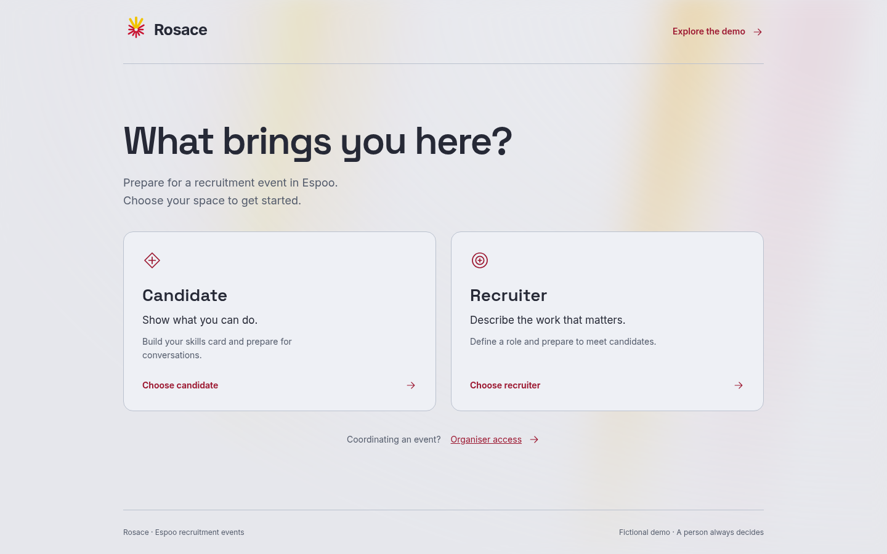

# Welcome and role homes

Owner-approved follow-up, 14 November 2026. This builds on the [Impeccable frontend review](UI_REVIEW.md), preserving the pearl Aurora, self-hosted typefaces and Centrale colours.

## What to try

1. Open `/`: choose **Candidate** or **Recruiter**. **Organiser access** is below the two main choices. **Explore the demo** opens `/tour` immediately.
2. The sign-in preview shows a read-only fictional address. Continue to the code step and enter the displayed `123456`, or choose **Skip sign-in preview**. No email is sent and no account is created.
3. The role home has one primary action: build a skills card, define a need or open the event desk. A saved local card/need supplies the rosace; an empty state does not invent levels.
4. Returning to `/` remembers only the chosen mode. **Demo profile → Back to welcome** returns to the choice. The profile menu also switches demo spaces and retains the selected check when moving between candidate answers and recruiter review.
5. The previous overview is preserved at `/overview`. The guided demo and all existing business screens remain available.

These are navigation choices in one browser, not permissions. Real email-code authentication, organiser invitations and shared data remain a later phase, after the owner reviews the flow.

## Local launch in Cursor

From the existing repository checkout, with local work committed or otherwise safely kept:

```bash
git fetch origin
git switch feat/coherent-ux
git pull --ff-only origin feat/coherent-ux
npm ci
npm run dev
```

Open http://localhost:3000 on the machine running the app. If the terminal reports a different port, use that address. Open http://localhost:3000/?choose=1 to force the welcome choice after choosing a role. No API key is required for this flow; optional configuration is in [CLAUDE_SETUP.md](CLAUDE_SETUP.md).

## Screenshots

| Screen | Desktop | Mobile |
| --- | --- | --- |
| Role choice | [1440px](images/welcome/welcome-1440.png) | [390px](images/welcome/welcome-390.png) |
| Fictional sign-in | [1440px](images/welcome/signin-1440.png) | [390px](images/welcome/signin-390.png) |
| Code preview | [1440px](images/welcome/code-1440.png) | [390px](images/welcome/code-390.png) |
| Recruiter home | [1440px](images/welcome/recruiter-1440.png) | [390px](images/welcome/recruiter-390.png) |
| Candidate home | [1440px](images/welcome/candidate-1440.png) | [390px](images/welcome/candidate-390.png) |
| Organiser home | [1440px](images/welcome/event-1440.png) | [390px](images/welcome/event-390.png) |
| Profile menu | [1440px](images/welcome/profile-1440.png) | [390px](images/welcome/profile-390.png) |



The test record is in [VALIDATION.md](VALIDATION.md). The source-backed review of the framing and Espoo challenge is in [CHALLENGE_ALIGNMENT.md](CHALLENGE_ALIGNMENT.md). No API, scoring, business storage, authentication service or database was changed in this follow-up; the only added storage is a browser navigation preference.
